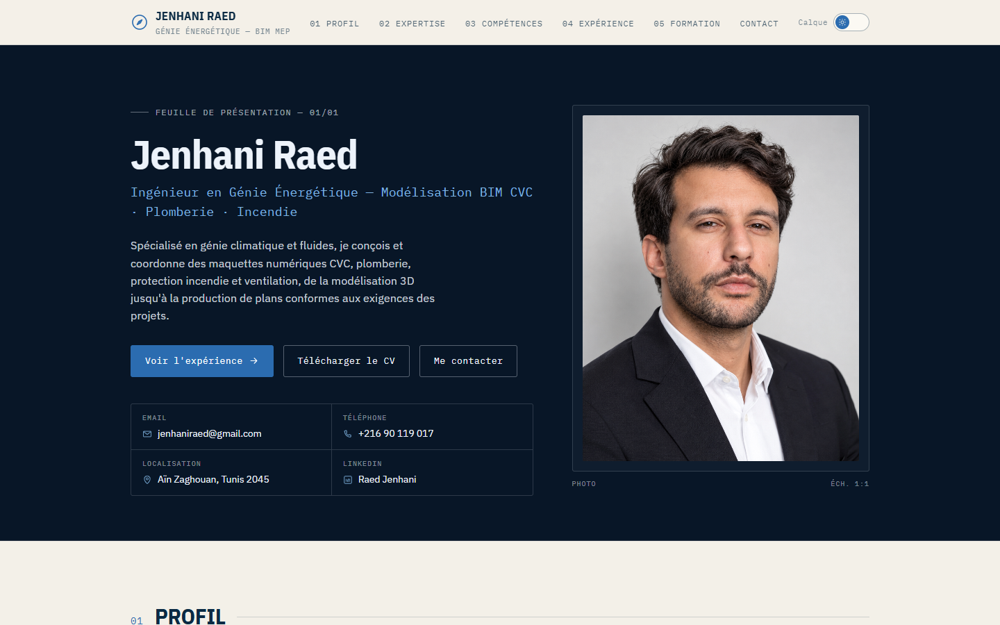
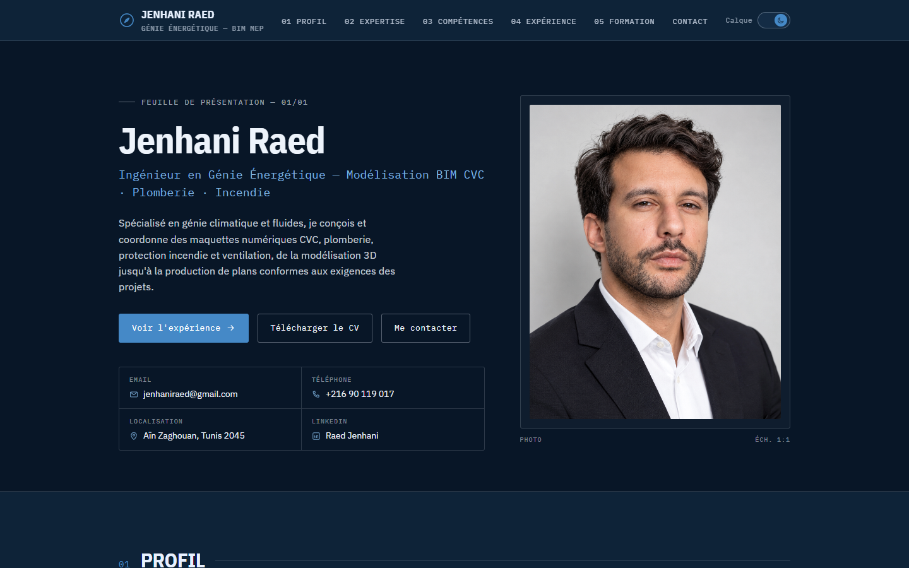
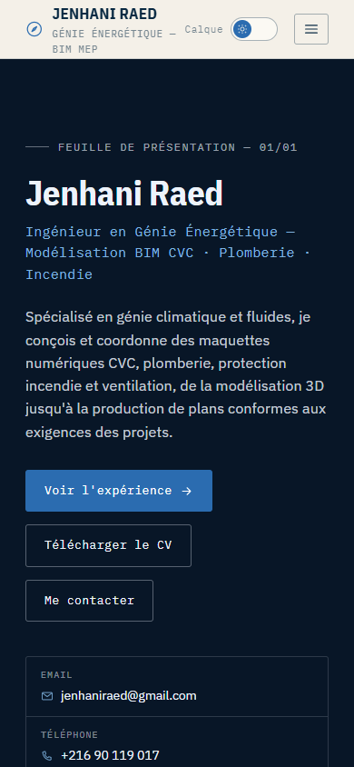
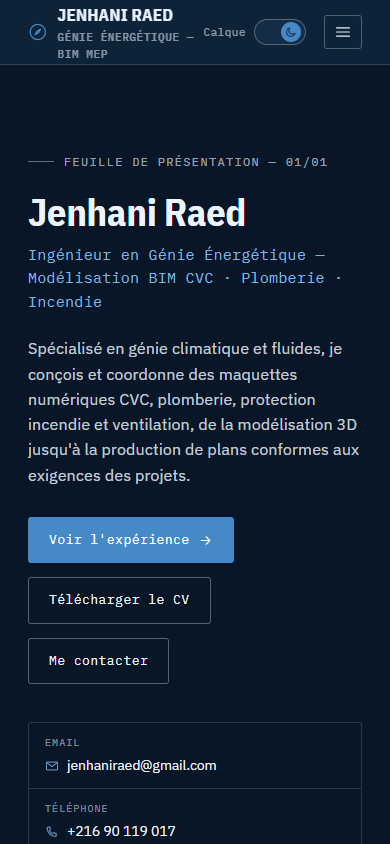
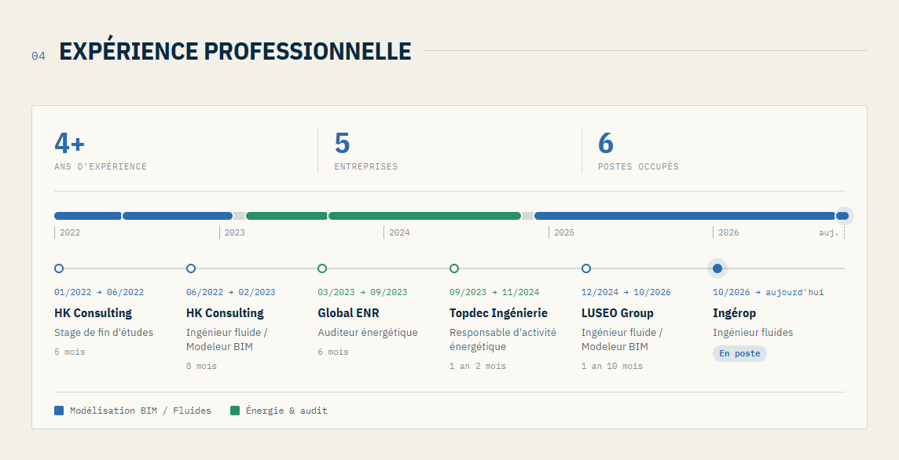
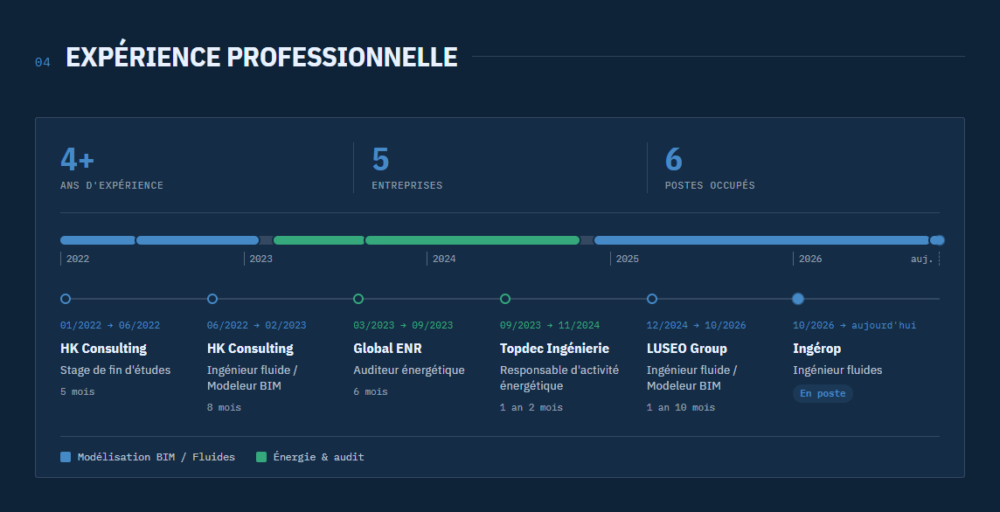
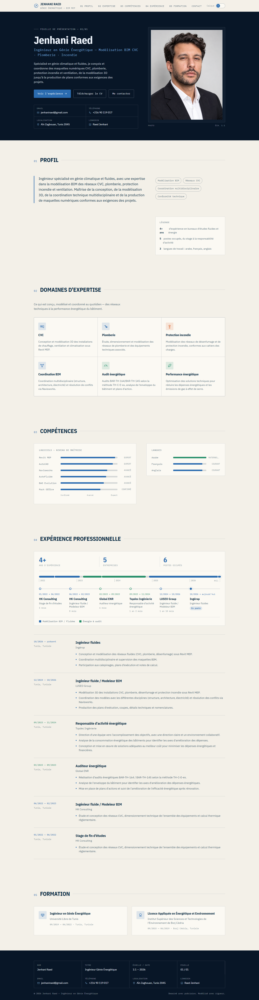
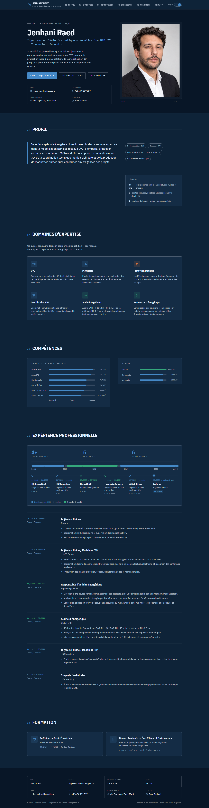

# Jenhani Raed — Portfolio

Site portfolio one-page pour **Jenhani Raed**, ingénieur en génie énergétique
spécialisé en modélisation BIM des réseaux CVC, plomberie, protection incendie
et ventilation.

Conçu et développé pour un ami, à partir de son CV.

**Site en ligne :** https://raedjenhani.github.io/cv/

Le site est construit en HTML/CSS/JS pur (sans framework ni étape de build) et
reprend l'esthétique d'un dossier de plans techniques : grille de calque,
lignes de cotation, numérotation de planches et cartouche, avec deux calques
de lecture — clair et sombre — commutables via l'interrupteur en haut à
droite.

## Aperçu

| Calque clair | Calque sombre |
|---|---|
|  |  |
|  |  |

### Expérience professionnelle

| Calque clair | Calque sombre |
|---|---|
|  |  |

La section expérience présente le parcours sous forme de ligne de carrière :
un résumé (années d'expérience, entreprises, postes), une barre
proportionnelle à la durée de chaque poste, puis une « station » par poste
avec dates, entreprise, intitulé et durée. Les largeurs, les repères
d'années, les durées et le total d'expérience sont recalculés à partir de la
date du jour à chaque chargement : le poste actuel s'allonge tout seul.

<details>
<summary>Page complète (clair / sombre)</summary>




</details>

## Structure

```
index.html     Contenu et structure de la page (une seule page, sections ancrées)
styles.css     Système de design (variables de thème clair/sombre, mise en page, responsive)
script.js      Bascule de thème, navigation mobile, scroll-spy, calcul de la ligne de carrière
image0.png     Photo de profil
Raed.pdf       CV téléchargeable
assets/        Favicon, image de partage (og-image), captures d'écran (screenshots/)
```

## Mettre à jour l'expérience

1. Ajouter ou modifier le poste dans la liste détaillée (`.role-list`) de
   `index.html`.
2. Dans la ligne de carrière (`.career`), ajouter ou modifier le segment
   `.seg` et la station `.step` correspondants, avec `data-start="AAAA-MM"`
   et, si le poste est terminé, `data-end="AAAA-MM"`. Sans `data-end`, le
   poste est considéré comme actuel (classe `is-current`).
3. Mettre à jour les compteurs « entreprises » et « postes occupés » si
   nécessaire. Le reste est recalculé automatiquement.

## Aperçu local

Aucune dépendance ni installation nécessaire : c'est un site statique.

```bash
python3 -m http.server 8000
# puis ouvrir http://localhost:8000
```

## Déploiement (GitHub Pages)

Le site est publié automatiquement par le workflow GitHub Actions
`.github/workflows/deploy-pages.yml` à chaque push sur `main` (ou à la
fusion d'une pull request). La mise en ligne prend en général une à deux
minutes ; l'avancement est visible dans l'onglet **Actions** du dépôt.

Dans **Settings → Pages**, la source doit être réglée sur **GitHub Actions**.
